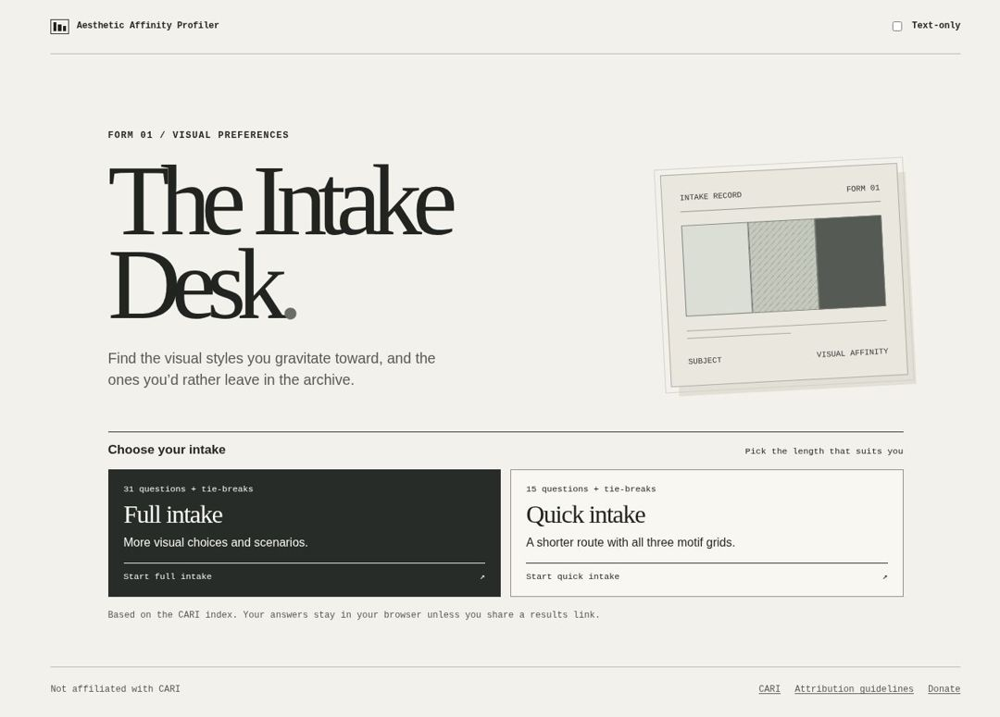
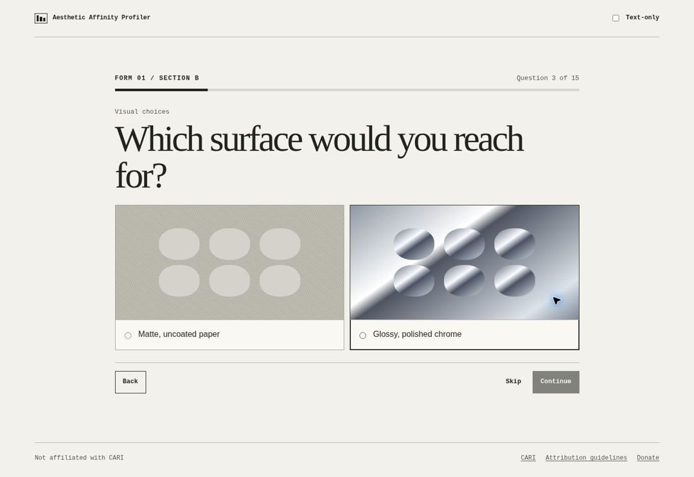
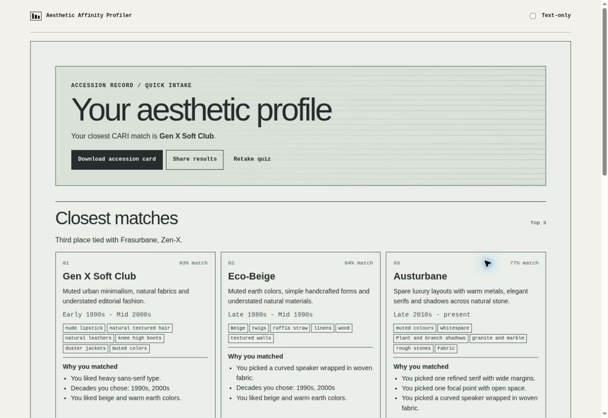

# Aesthetic Affinity Profiler

The Aesthetic Affinity Profiler uses the [Consumer Aesthetics Research Institute index](https://cari.institute/aesthetics) as its catalog.

## Refresh the catalog

Use a supported Node.js version (see `package.json`).

```sh
npm ci
npx playwright install chromium
npm run scrape:cari
npm run check:scraper
```

The scraper scrolls through CARI's live index, checks the count and uniqueness of the rendered entries, then waits 1.5 seconds before each sequential entry visit. It writes the finished snapshot to `data/cari_snapshot_<UTC date>.json`. To use system Chromium, set `PLAYWRIGHT_CHROMIUM_EXECUTABLE_PATH`.

If Chromium cannot run, `npm run scrape:cari -- --http` reads the index and its official pagination endpoint, then fetches only the entry HTML. For offline verification of a capture, set `CARI_CAPTURE_DIRECTORY` in this mode to a folder with `index.html`, `page-1.json` onward and one `<slug>.html` per entry.

The snapshot preserves CARI's text and entry-level researcher credits. Timeline endpoints come from the index when the entry omits them. Empty lists indicate the source provided no structured items. Related entries use CARI slugs. The snapshot contains text and links. See [CARI's attribution guidelines](https://cari.institute/attribution-guidelines).

## Review the dimension tags

`data/dimensions.json` defines 16 dimension groups. Ordinal values run from −2 to +2.
A blank ordinal cell means that the CARI text supplies insufficient evidence for the
axis. Zero means the source supports a midpoint or a mix of both poles.
Multi-hot cells use JSON arrays, with `[]` for an unassigned group. Active decades
come from the description where it identifies the aesthetic's period. The decade
group is reserved for the separate era prior.

The seed judgments in `data/cari_tag_seed.json` use the snapshot's CARI
descriptions and listed motifs. Run `npm run tags:draft` to generate a review
sheet from that seed. The command preserves edits in an existing review file.
In `data/cari_tag_review.csv`, review each vector, confidence level, and motif
against its linked CARI entry. The draft identifies each motif's source as the
motif list or a verbatim phrase from the description. Sparse entries are flagged
for review. `motif_provenance` is regenerated when publishing from the approved
motif selections.

For the agreement check, have two reviewers independently tag the same 20
entries before showing them the draft. Compare exact and within-one-point
agreement on jointly rated ordinal axes, and Jaccard similarity on jointly
populated categorical groups. Report how often each reviewer left a group
unassigned and resolve disagreements in the review sheet.

Set `approval` to `approved` after checking a row. Run `npm run tags:check` to
validate the sheet. `npm run tags:publish` writes `data/aesthetics.json` once all
rows are approved and each has three to eight source-backed motifs.

## Case study

People recognize a mood long before they know its design-history name. This quiz
turns reactions to specific visual choices into a ranked set of CARI entries.
The Intake Desk uses a neutral form during questioning. The visual language of
the closest match appears after scoring.







### Question method

Full intake contains 36 fixed questions. Two scenarios explore architectural decisions about a public entrance and an arts-center interior. Visitors consider thresholds, circulation, scale, daylight, material, and ornament through pictured examples and plain-language descriptions. The default Quick intake has 15, including three 12-tile motif grids. Both add up to four conditional tie-breaks. The 12-screen Quick proposal has one motif grid and up to three top tie-breaks. It is available for review with `?quickDraft=1`. The optional `?adaptive=1` flag reorders remaining scored choices within a section.

Every fixed question has illustrated choices or slider endpoints, including the first warm-up. The 12 visual pairs isolate one or two scored differences. Selecting “Neither” contributes zero evidence. Visitors may choose two design contexts. The scorer averages those selections so answering twice gives the context screen the same weight as a single selection.

The image manifest records each original illustration, source asset, attribution and accessible description. Tie-breaks use distinct representative details, with dedicated illustrated comparisons for two frequently confused pairs. Text-only mode retains the captions and controls.

The full-bank coverage check requires each approved entry to have at least three distinct questions outside the warm-up with either a matching signature motif or option-vector cosine similarity of at least 0.45. This is an authoring check. Human playtests assess whether participants interpret the images as intended.

The runtime catalog uses the 78 approved entries with at least three source-backed
motifs. The remaining 12 stay in the review sheet. `npm run tags:export-quiz`
rebuilds the eligible subset from the approved rows. Add a paraphrase to
`data/summaries.json` when adding an eligible entry.

### Scoring

Ordinal axes use a −2 to +2 scale. Multi-hot fields flatten into binary
coordinates. Decades stay in a separate prior. A forced choice contributes
+1 for the chosen option and −0.5 for the rejected option. A scenario contributes
+1 for the chosen option and −0.25 per rejected option. The engine counts
exposures on coordinates that distinguish the offered options. Motif reactions
contribute +1.5 for love and −2 for dislike, with one-quarter of that signal
added to the tile's dimension vector. Sliders contribute 1.5 times the selected
value. Each dimension is divided by the square root of its exposure count plus
one.

```text
score = (0.65 × cosine similarity + 0.25 × motif affinity + 0.10 × era overlap) × confidence
match = clamp(round(50 + 50 × score), 1, 99)
```

Motif affinity averages bounded reaction scores for the style's shown motifs.
The era prior is the fraction of selected decades shared with the style.
Confidence multipliers are 0.8, 0.9, and 1.0 for low, medium, and high confidence.
A bottom result requires at least two shown motifs or four relevant answered
probes. Ties within 0.05 of the third-place boundary receive up to four additional
choices between nearby candidates. Remaining ties are shown on the result.
Explanations use leave-one-answer-out contributions to the displayed score.

### Validation and playtesting

The seeded simulation tests 200 noisy personas per eligible aesthetic in each
mode. [The simulation report](reports/simulation.md) includes recovery rates,
confusion pairs, observed reachability, and per-style results. Unit and DOM
tests cover weights, evidence floors, tie-breaks, theme contrast, Quick Mode,
text-only interaction, and URL sharing. The simulator uses the reviewed taste
vectors for both persona generation and scoring. Human reliability is pending.

Invite 10–15 participants to use `?playtest=1`. Have each take the same mode
twice about a week apart, using the same pseudonymous code. Results offer a
downloadable JSON record with the top three and a five-point #1 fit rating.
Collect the downloaded files and summarize them with
`npm run playtest:summary -- path/to/records/*.json`. The test–retest target is
at least two shared top-three entries. The tool does not upload participant data.

### Run and deploy

```sh
npm ci
npm run dev
npm test
npm run build
npm run simulate
```

This Vite + React + TypeScript site builds to `dist/` and uses relative asset
paths for GitHub Pages. The repository's Pages publishing source should be
**GitHub Actions**. The workflow builds, tests, and publishes on `main`.
Results URLs encode answers in the fragment. No account or backend is required.
Share only results you are comfortable disclosing.

Catalog names, source text, and credits come from the
[Consumer Aesthetics Research Institute](https://cari.institute/).
The project is independent of CARI. See their
[attribution guidelines](https://cari.institute/attribution-guidelines)
and [donation page](https://donorbox.org/support-cari).

After the reveal, the catalog can be searched by name, description, or motif and
filtered by decade, palette, material, or context. Paste a second results link
to compare the two profiles in the browser without uploading answers.