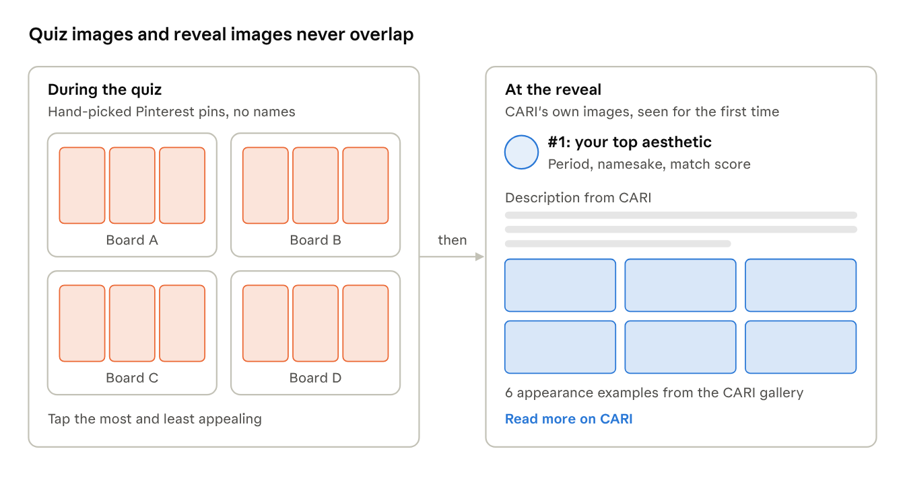
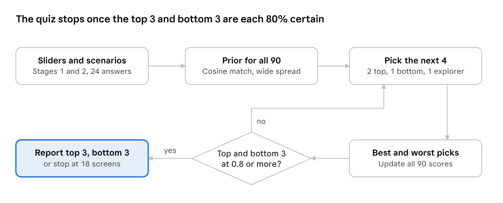
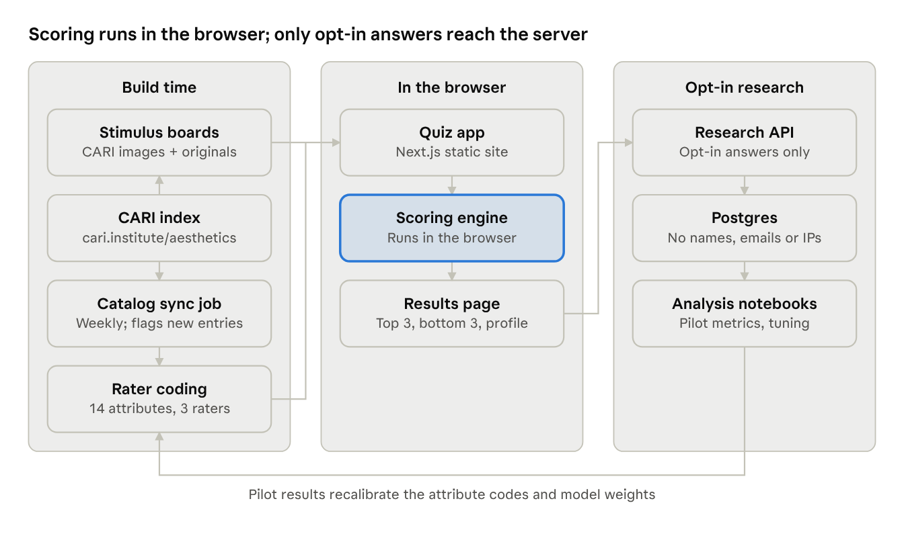
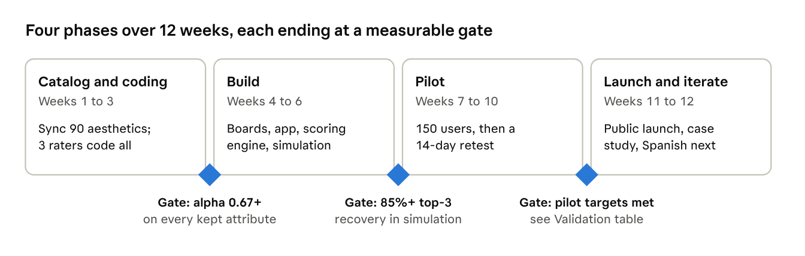

# Aesthetic Affinity Profiler: A Psychometric Quiz for Ranking Consumer Aesthetics

Nov 22, 2026 · @Max

## Executive summary

The Aesthetic Affinity Profiler is an adaptive quiz. In about 10 minutes it ranks all 90 aesthetics in the [Consumer Aesthetics Research Institute (CARI) index](https://cari.institute/aesthetics) for one person, then reports their top 3 and bottom 3, each with a confidence level.

Most aesthetic quizzes are personality-style: a handful of questions, a hard-coded answer key, and one result. That breaks down with 90 options. People also struggle to name what they like, and a design they merely recognize can pass for one they actually love. This plan treats the problem as preference measurement instead:

1.  **Encode the catalog.** Two or more trained raters score every CARI aesthetic on 14 design attributes, such as palette, ornament, material and mood. Agreement between raters is measured before the codes are used.

2.  **Profile the person.** Attribute and scenario questions place the user on those same 14 attributes. This gives a prior estimate for all 90 aesthetics.

3.  **Ask directly.** Best-worst scaling (MaxDiff) screens show images of 4 unnamed aesthetics at a time, drawn from hand-picked Pinterest pins so that CARI's own galleries stay unseen until the reveal, and the user picks the most and least appealing. A single screen sharpens both ends of the ranking at once, which suits a top-3 and bottom-3 output.

4.  **Decide with confidence.** A Bayesian model updates after every answer and stops when it is 80% sure of the top 3 and bottom 3, or after 18 MaxDiff screens.

Success is measured, not assumed. A 150-person pilot targets test-retest top-3 overlap of at least 0.6, holdout-rating correlation of at least 0.6, and 75% of users rating their result as accurate.

**Building this with an AI coding agent?** Give it this whole document, exported as Markdown, and point it to the Build spec section. That section turns the plan into ordered tasks, file formats and pass/fail tests.

## Background and scope

The option set is the CARI index and nothing else. CARI is a volunteer nonprofit that catalogs consumer aesthetics from the 1970s onward. It coined or popularized names now in wide use, including Y2K, Frutiger Aero and Global Village Coffeehouse ([FAQ](https://cari.institute/faq), [Readymag](https://blog.readymag.com/aesthetic-labels/)).

**What CARI gives us.** Each aesthetic page lists a name, namesake, description, period of relevance, sorted decade, alternate names, attribution, an Are.na link and a gallery. For example, [Global Village Coffeehouse](https://cari.institute/aesthetics/global-village-coffeehouse) runs from the late 1980s to the mid 1990s. [Whimsigothic](https://cari.institute/aesthetics/whimsigothic) runs from the late 1980s to the late 1990s.

**What CARI does not give us.** The pages have no structured fields for color, shape, material or mood. Those are the variables a quiz needs, so the project builds them (see Aesthetic taxonomy).

**Goals**

- Rank all aesthetics in the live CARI index (90 in the sitemap as of this writing) for each user.

- Report top 3 and bottom 3, each with a confidence level and the attributes behind it.

- Finish in 8 to 12 minutes on a phone.

- Show the method is reliable and valid with pilot data.

- Send users back to CARI, with every result linking to its CARI page.

**Non-goals**

- Adding, renaming or redefining aesthetics. CARI's taxonomy stays authoritative.

- Inferring personality, demographics or anything about the user beyond taste.

- Using CARI gallery images without CARI's permission. They are pulled only after CARI agrees (see Sourcing reveal images from CARI). CARI notes its images belong to their original owners under fair use ([FAQ](https://cari.institute/faq)).

**Open question:** will CARI grant permission to use its gallery images, aesthetic icons and short descriptions in the quiz? Asking, via contact \[at\] cari.institute, is the first task of week 1. The quiz still works without them (see Risks).

## Aesthetic taxonomy

Each aesthetic is turned into a 14-number profile. Every attribute is scored from −2 to +2 between two named poles, and the same scale is used for users. That shared space is what lets the quiz compare a person to all 90 aesthetics.

The example codes below are illustrative. The coding team sets the final values using the protocol that follows.

| \#  | Attribute           | −2 pole             | +2 pole              | Frutiger Aero | Global Village Coffeehouse | Whimsigothic |
|-----|---------------------|---------------------|----------------------|---------------|----------------------------|--------------|
| 1   | Palette temperature | Cool (blue, silver) | Warm (orange, brown) | −2            | +2                         | 0            |
| 2   | Saturation          | Muted, earthy       | Vivid, neon          | +1            | −1                         | −1           |
| 3   | Lightness           | Dark, moody         | Bright, airy         | +2            | 0                          | −2           |
| 4   | Ornament density    | Minimal             | Maximal              | 0             | +1                         | +2           |
| 5   | Geometry            | Angular, grid       | Curvy, blobby        | +1            | +1                         | +1           |
| 6   | Surface             | Matte, flat         | Glossy, chrome       | +2            | −2                         | −1           |
| 7   | Texture             | Clean, digital      | Handmade, distressed | −2            | +2                         | +1           |
| 8   | Material            | Synthetic           | Natural, organic     | +1            | +2                         | 0            |
| 9   | Time orientation    | Nostalgic, revival  | Futuristic           | +2            | −1                         | −1           |
| 10  | Tone                | Earnest             | Playful, ironic      | −1            | −1                         | 0            |
| 11  | Status              | Budget, mass-market | Luxe, aspirational   | 0             | 0                          | 0            |
| 12  | Context             | Corporate           | Subcultural, DIY     | −1            | +1                         | +1           |
| 13  | Imagery             | Abstract, graphic   | Figurative motifs    | +1            | +2                         | +2           |
| 14  | Typography          | Clean sans          | Decorative display   | −2            | +1                         | +1           |

CARI's own sorted decade (1970s to 2010s) is kept as a 15th, categorical field. It is used only for diversity in item selection, never for scoring, so that era nostalgia does not swamp visual taste.

**Coding protocol**

1.  **Sync the catalog.** A script reads the CARI sitemap and each aesthetic page, storing the name, period, decade and URL. It reruns before every release so that new aesthetics are flagged for coding.

2.  **Train the raters.** Three raters work from a codebook that defines each pole with anchor examples, then calibrate on 10 shared aesthetics.

3.  **Code independently.** Each rater scores every aesthetic from its CARI page and Are.na board. Budget about 10 minutes per aesthetic, or roughly 45 rater-hours in total.

4.  **Measure agreement.** Compute Krippendorff's alpha per attribute. Keep an attribute at 0.67 or above, and revise or drop it below that.

5.  **Resolve disagreement.** The final code is the median. Any aesthetic where raters differ by more than 2 points is discussed and recoded.

6.  **Tag signature cues.** Record 3 to 5 concrete cues per aesthetic (for example, woodcut suns or glossy water droplets). Scenario questions and stimulus boards are built from these.

**Full option set: the 90 aesthetics in the [CARI sitemap](https://cari.institute/sitemap.xml)**

Display names here come from page URLs. The sync job replaces them with the exact names on each page.

[Acidgrafix](https://cari.institute/aesthetics/acidgrafix) · [Airbrush Surrealism](https://cari.institute/aesthetics/airbrush-surrealism) · [Austurbane](https://cari.institute/aesthetics/austurbane) · [Blob World](https://cari.institute/aesthetics/blob-world) · [Boho Chic](https://cari.institute/aesthetics/boho-chic) · [Bubblegum Bling](https://cari.institute/aesthetics/bubblegum-bling) · [Cassette Futurism](https://cari.institute/aesthetics/cassette-futurism) · [Contempo Eclectic](https://cari.institute/aesthetics/contempo-eclectic) · [Corporate Cyberspace](https://cari.institute/aesthetics/corporate-cyberspace) · [Corporate Grunge](https://cari.institute/aesthetics/corporate-grunge) · [Corporate Hippie](https://cari.institute/aesthetics/corporate-hippie) · [Corporate Memphis](https://cari.institute/aesthetics/corporate-memphis) · [Corporate Scene](https://cari.institute/aesthetics/corporate-scene) · [Corporate Synthwave](https://cari.institute/aesthetics/corporate-synthwave) · [Corporate Vaporwave](https://cari.institute/aesthetics/corporate-vaporwave) · [Curly Girly](https://cari.institute/aesthetics/curly-girly) · [Cyberbougie](https://cari.institute/aesthetics/cyberbougie) · [Cyberdelia](https://cari.institute/aesthetics/cyberdelia) · [Deco Luxe](https://cari.institute/aesthetics/deco-luxe) · [Decoplex](https://cari.institute/aesthetics/decoplex) · [Diner Kitsch](https://cari.institute/aesthetics/diner-kitsch) · [Disco Deco](https://cari.institute/aesthetics/disco-deco) · [Dollar Store Vernacular](https://cari.institute/aesthetics/dollar-store-vernacular) · [Early Cyber](https://cari.institute/aesthetics/early-cyber) · [Eco Beige](https://cari.institute/aesthetics/eco-beige) · [Electroclash](https://cari.institute/aesthetics/electroclash) · [Factory Pomo](https://cari.institute/aesthetics/factory-pomo) · [Festival Marketplace](https://cari.institute/aesthetics/festival-marketplace) · [Four Colors](https://cari.institute/aesthetics/four-colors) · [Frasurbane](https://cari.institute/aesthetics/frasurbane) · [Frutiger Aero](https://cari.institute/aesthetics/frutiger-aero) · [Gay Nineties Revival](https://cari.institute/aesthetics/gay-nineties-revival) · [Genericana](https://cari.institute/aesthetics/genericana) · [Gen X Home](https://cari.institute/aesthetics/gen-x-home) · [Gen X Soft Club](https://cari.institute/aesthetics/gen-x-soft-club) · [Global Village Coffeehouse](https://cari.institute/aesthetics/global-village-coffeehouse) · [Googie Kitsch](https://cari.institute/aesthetics/googie-kitsch) · [Graffiti Pop](https://cari.institute/aesthetics/graffiti-pop) · [Groovival](https://cari.institute/aesthetics/groovival) · [Hexatron](https://cari.institute/aesthetics/hexatron) · [Hipness Purgatory](https://cari.institute/aesthetics/hipness-purgatory) · [Indiecraft](https://cari.institute/aesthetics/indiecraft) · [Indie Sleaze](https://cari.institute/aesthetics/indie-sleaze) · [Industrial Americana](https://cari.institute/aesthetics/industrial-americana) · [Industrial Gothic](https://cari.institute/aesthetics/industrial-gothic) · [Internet Awesomesauce](https://cari.institute/aesthetics/internet-awesomesauce) · [Jumbled Font](https://cari.institute/aesthetics/jumbled-font) · [Laser Grid](https://cari.institute/aesthetics/laser-grid) · [Live Laugh Love](https://cari.institute/aesthetics/live-laugh-love) · [McBling](https://cari.institute/aesthetics/mcbling) · [Memphis Jr](https://cari.institute/aesthetics/memphis-jr) · [Memphis Milano](https://cari.institute/aesthetics/memphis-milano) · [Metalheart](https://cari.institute/aesthetics/metalheart) · [Mid-Century Medieval](https://cari.institute/aesthetics/mid-century-medieval) · [Millennium Disco](https://cari.institute/aesthetics/millennium-disco) · [Mission School](https://cari.institute/aesthetics/mission-school) · [Neoclassical Pomo](https://cari.institute/aesthetics/neoclassical-pomo) · [Neon Ooze](https://cari.institute/aesthetics/neon-ooze) · [Neo Vectorheart](https://cari.institute/aesthetics/neo-vectorheart) · [Neo Y2K](https://cari.institute/aesthetics/neo-y2k) · [New Wave Tropical](https://cari.institute/aesthetics/new-wave-tropical) · [Nouveau Organic](https://cari.institute/aesthetics/nouveau-organic) · [Nu-Brutalism](https://cari.institute/aesthetics/nu-brutalism) · [Pacific Punk Wave](https://cari.institute/aesthetics/pacific-punk-wave) · [Paperback Chic](https://cari.institute/aesthetics/paperback-chic) · [Pastel Southwestern](https://cari.institute/aesthetics/pastel-southwestern) · [Pixelscape](https://cari.institute/aesthetics/pixelscape) · [Polychrome](https://cari.institute/aesthetics/polychrome) · [Pomo Faux Ruins](https://cari.institute/aesthetics/pomo-faux-ruins) · [Preschool Pop](https://cari.institute/aesthetics/preschool-pop) · [Pulp Fantasy](https://cari.institute/aesthetics/pulp-fantasy) · [Rad Dog Neon Surf](https://cari.institute/aesthetics/rad-dog-neon-surf) · [Radical Surrealism](https://cari.institute/aesthetics/radical-surrealism) · [Renaissance Revival](https://cari.institute/aesthetics/renaissance-revival) · [Silicon Dreams](https://cari.institute/aesthetics/silicon-dreams) · [Soft Colonial Wanderlust](https://cari.institute/aesthetics/soft-colonial-wanderlust) · [Sportsbrut](https://cari.institute/aesthetics/sportsbrut) · [Superflat Pop](https://cari.institute/aesthetics/superflat-pop) · [Supergraphic Ultramodern](https://cari.institute/aesthetics/supergraphic-ultramodern) · [Themed Spaces](https://cari.institute/aesthetics/themed-spaces) · [Ultramodern Revival](https://cari.institute/aesthetics/ultramodern-revival) · [Urban Grunge](https://cari.institute/aesthetics/urban-grunge) · [Utopian Scholastic](https://cari.institute/aesthetics/utopian-scholastic) · [Vectorheart](https://cari.institute/aesthetics/vectorheart) · [Vector Minimalism](https://cari.institute/aesthetics/vector-minimalism) · [Wacky Pomo](https://cari.institute/aesthetics/wacky-pomo) · [Whimsicraft](https://cari.institute/aesthetics/whimsicraft) · [Whimsigothic](https://cari.institute/aesthetics/whimsigothic) · [Y2K Aesthetic](https://cari.institute/aesthetics/y2k-aesthetic) · [Zen-X](https://cari.institute/aesthetics/zen-x)

## Question design

The quiz runs in four stages, moving from abstract taste to direct comparison. The early stages are cheap and cover all 90 aesthetics at once. The final stage spends the user's attention only where the ranking is still uncertain.

| Stage                 | Format                                                                          | Items                | Time   | What it measures                                                        |
|-----------------------|---------------------------------------------------------------------------------|----------------------|--------|-------------------------------------------------------------------------|
| 1\. Attribute sliders | Two neutral swatch boards at opposite poles, with a 5-point slider between them | 14 + 2 repeat checks | ~3 min | Where the user sits on each of the 14 attributes                        |
| 2\. Scenario choices  | Pick 1 of 4 mood boards for an everyday setting                                 | 8                    | ~2 min | Attribute combinations in context, which catch tastes that sliders miss |
| 3\. Adaptive MaxDiff  | 4 unnamed boards of Pinterest images per screen; tap most and least appealing   | 10 to 18             | ~4 min | Direct preference between specific aesthetics                           |
| 4\. Confirm           | Named top 5 and bottom 5, with CARI images; flag any that feel wrong            | 1                    | ~1 min | User agreement, plus validation data                                    |

**Stage 1: attribute sliders.** Each item shows two boards built from plain swatches, shapes or textures rather than real aesthetics. For example: "Which surface feels more like you?" with matte paper on the left and glossy chrome on the right. Two items repeat later with the sides swapped, which flags careless or random answers.

**Stage 2: scenario choices.** Each option is an original mood board assembled from signature cues, never copied artwork. The eight settings:

1.  A coffee shop you would spend an afternoon in

2.  A hotel lobby you would book

3.  A phone lock screen

4.  A living room

5.  An album cover you would pick up

6.  A birthday party invitation

7.  A website you would trust with your email

8.  A pair of sneakers

Each option carries an attribute vector. Picking it nudges the user's profile toward that vector.

**Stage 3: adaptive MaxDiff.** This is the core measurement. Each aesthetic is shown as a same-size board of 3 images from its curated Pinterest board, with no name. The algorithm picks which 4 to show (see Scoring model). It mixes likely favorites, likely dislikes and uncertain middles, and never puts two from the same decade on one screen.

**Stage 4: confirm.** The named results appear, and the user can mark any as "not me." The reported result is still the model's pre-confirmation ranking. Flags are logged as a validity signal and used to improve the attribute codes. The user also answers "Had you seen this before?" for each top-3 aesthetic.

**Item-writing rules**

- Hide names until results. Familiar labels like Y2K would otherwise win on recognition alone.

- Match every board on size, resolution and image count, so that image quality does not drive choices.

- Randomize option position on every screen.

- No readable logos, brand names or recognizable characters on any board. When curating Pinterest or CARI images, skip those that show them.

- Write prompts in plain language at about an 8th-grade reading level, with a Spanish version in phase 2.

- Give colorblind-safe contrast and alt text for every board.

**Images in every question**

Every image has a job, and none is there for decoration. The quiz keeps two separate image pools. Questions use original images and hand-picked Pinterest pins, while CARI's own galleries are held back for the results. A user sees no CARI image until the reveal, so the reveal collage feels new rather than familiar.

two image pools · quiz screen vs. reveal card

Pinterest pins carry the measurement, and CARI's gallery is the reward. No image appears in both.

| Stage                   | What each question shows                                     | Why the image is needed                                                                               | Image source                                                  | Caption                                                              |
|-------------------------|--------------------------------------------------------------|-------------------------------------------------------------------------------------------------------|---------------------------------------------------------------|----------------------------------------------------------------------|
| 1\. Attribute sliders   | 2 images, one per pole                                       | Words like "glossy" or "warm" mean different things to different people. A picture fixes the meaning. | Original photos or licensed stock                             | Yes, for example "Matte paper"                                       |
| 2\. Scenario choices    | 4 option images                                              | People spot a café they would like faster than they can describe one.                                 | Original mood boards or licensed stock                        | Yes, the scene only                                                  |
| 3\. Adaptive MaxDiff    | 4 unnamed boards of 3 images each                            | The images are the measurement: people choose a look, not a label.                                    | Hand-picked Pinterest pins, shown with Pinterest's Pin widget | None. Alt text describes what is shown without naming the aesthetic. |
| 4\. Confirm and results | Each named aesthetic with its icon and 6 appearance examples | The payoff: it shows what the name means, in CARI's own curation.                                     | CARI gallery, via the Are.na API                              | "Image via CARI," linked                                             |

**Where images are left out:** the consent screen, the stopping message and the confidence labels. Text does those jobs on its own, and extra images would only slow the quiz down on a phone.

**Sourcing quiz images from Pinterest**

Pinterest is a hand-curated source here, never a scraped one. Pinterest's terms prohibit scraping or collecting its data without prior authorization, and its API has no pin search ([Pinterest API team](https://community.pinterest.biz/t/inquiry-about-using-pinterest-images-and-obtaining-official-permission/39124)). So raters choose the pins, and the quiz shows them through Pinterest's own embed.

1.  **Shortlist by hand.** For each aesthetic, a rater searches Pinterest the normal way and saves 6 to 9 candidate pins to a team board. Budget about 10 minutes per aesthetic, or 15 rater-hours for all 90.

2.  **Screen for spoilers.** Reject any pin that shows the aesthetic's name, a CARI watermark, or overlay text such as "Y2K aesthetic." The curation sheet shows the aesthetic's CARI gallery beside each candidate. Many pins are re-posts of images CARI also collects, so the rater drops any pin that repeats a CARI image.

3.  **Pick 3 per board.** Keep the 3 pins that show the aesthetic's signature cues most clearly. Skip readable logos, real people's faces and low-resolution images.

4.  **Embed, don't copy.** Show each pin with Pinterest's official Pin widget, which can show a pin with or without its description ([Pinterest add-ons](https://help.pinterest.com/en/business/article/build-a-website-widget), [builder options](https://keywordseverywhere.com/tools/pinterest-widget-builder/)). Turn the description off, since pin descriptions often name the aesthetic. The pin stays linked to Pinterest, so credit travels with the image.

5.  **Load the script once.** The Pin widget runs on Pinterest's pinit.js script ([Pinterest widget docs](https://developers.pinterest.com/docs/web-features/widgets/)). Load it once per page, only on Stage 3 screens, and name it in the privacy notice as a third-party script.

6.  **Check links weekly.** Pins get deleted. The sync job checks every pin URL and swaps a dead pin for the next one on the shortlist.

7.  **Trace to the original.** When a pin leads to a clear original, such as a designer's portfolio or a brand archive, record that source with the stimulus. Before public launch, ask that owner for permission or replace the pin.

**Trade-offs.** The widget controls its own frame and shows Pinterest branding, so pins will not match exactly in size. Boards use a fixed grid at one widget size to keep them close. If Pinterest embeds fail to load or become unavailable, the board falls back to an original one built from the aesthetic's signature cues.

**Sourcing reveal images from CARI**

1.  **Ask permission.** Email CARI with this plan. Ask to show its gallery images and icons in the quiz and results, and to cache resized copies on the quiz's CDN, and ask how CARI wants credit given.

2.  **Pull.** The catalog sync job reads each aesthetic page for its icon and Are.na link. It then calls the Are.na API's channel-contents endpoint (GET /v3/channels/{id}/contents), which returns each image's original URL, resized versions and source ([Are.na API docs](https://www.are.na/developers/explore/channel/contents)).

3.  **Curate.** Raters shortlist 6 to 9 images per aesthetic and pick the 6 that show its signature cues most clearly. They skip images with readable logos, real people's faces or low resolution. Budget about 5 minutes per aesthetic.

4.  **Record.** Store each image's CARI page, Are.na block ID, original source URL, caption and credit with the stimulus.

5.  **Serve.** If CARI allows caching, resize the images to WebP on the CDN. Otherwise load them from Are.na's image URLs at runtime with lazy loading, and fall back to an original board if one fails to load.

6.  **Credit.** Each image shows "Image via CARI," linked to the aesthetic's CARI page and to the original source when it is known.

7.  **Take down.** Remove any image within 48 hours of a request from CARI or a rights holder. The sync job also drops images that CARI removes from its boards.

## Scoring model

Every aesthetic j gets a latent appeal score θⱼ for this user, held as a probability distribution rather than a single number. Stages 1 and 2 set the starting distribution. Each MaxDiff screen narrows it, and the quiz stops once the top 3 and bottom 3 are settled.

scoring loop · 5 steps, 1 decision

Each pass through the loop is one MaxDiff screen. The loop runs at least 10 times and at most 18.

**Step 1: build the user profile.** The slider answers form the user vector u (14 values, each from −2 to +2). Each scenario pick moves u halfway toward the chosen option's vector.

**Step 2: set the prior.** Starting appeal is the cosine similarity between the user and each aesthetic's code vector aⱼ, scaled by λ = 1.5. The variance is kept wide (σ₀² = 1.0) because the attribute match is only a first guess.

\mu\_{0,j} = \lambda \cdot \frac{u \cdot a_j}{\lVert u \rVert \\ \lVert a_j \rVert}, \qquad \theta_j \sim \mathcal{N}(\mu\_{0,j}, \sigma_0^2)

**Step 3: update from MaxDiff.** Each screen S of 4 aesthetics gives a best pick b and a worst pick w. They are modeled with the sequential best-worst logit, a standard choice model for MaxDiff data:

P(b, w \mid S) = \frac{e^{\theta_b}}{\sum\_{k \in S} e^{\theta_k}} \cdot \frac{e^{-\theta_w}}{\sum\_{k \in S \setminus \\b\\} e^{-\theta_k}}

After each screen, a Laplace approximation (a few Newton steps over 90 parameters) gives the new mean and variance for every aesthetic. This takes milliseconds and runs in the browser.

**Step 4: pick the next screen.** Each screen of 4 is filled by role:

- **2 top-boundary items:** the highest-variance aesthetics currently ranked 2 to 6

- **1 bottom-boundary item:** the highest-variance aesthetic currently ranked 85 to 89 (or N−5 to N−1 as the catalog grows)

- **1 explorer:** the highest-variance aesthetic anywhere, so a bad prior can still be corrected

No two items on a screen share a CARI decade. No aesthetic can be reported in the top 3 or bottom 3 unless it has appeared on at least 2 screens.

**Step 5: decide and stop.** Draw 2,000 samples from the posterior and count how often each aesthetic lands in the top 3 and the bottom 3:

P\_{\text{top}}(j) = \frac{1}{2000} \sum\_{s=1}^{2000} \mathbf{1}\left\[\operatorname{rank}\_s(j) \le 3\right\]

The quiz stops when all three reported top picks and all three bottom picks reach a membership probability of 0.8. It runs at least 10 screens and at most 18. Each result carries a label: High (0.8 or more), Medium (0.6 to 0.8) or Low (below 0.6).

**Calibration after the pilot.** λ, σ₀² and the scenario weight start as the values above. Pilot data then tunes them, and a population-level weight per attribute is learned, since palette may matter more to most people than typography.

## Validation and quality

The quiz is judged against targets set before the pilot runs. A result that clears these bars is evidence that the quiz measures stable taste, not noise or name recognition.

**Pilot design**

- **Sample:** 150 adults (18+), recruited from design, fashion and retro-media communities plus general social channels, so that the pilot is not only aesthetics enthusiasts. At 150, a 75% accuracy rating carries a 95% margin of about ±7 points.

- **Session 1:** the full quiz, then a holdout task rating 20 randomly chosen aesthetics from 1 to 7. Holdout ratings never feed the model.

- **Session 2, after 14 days:** the full quiz again, aiming to retain at least 100 people.

- **Ablation:** score every session three ways (prior only, MaxDiff only, full model) to show each stage earns its time.

| Metric                 | How it is measured                                      | Target               |
|------------------------|---------------------------------------------------------|----------------------|
| Coding reliability     | Krippendorff's alpha per attribute, 3 raters            | ≥ 0.67 per attribute |
| Top-3 stability        | Share of top-3 picks repeated at retest                 | ≥ 0.6 (about 2 of 3) |
| Bottom-3 stability     | Same, for bottom 3                                      | ≥ 0.6                |
| Rank stability         | Spearman correlation of full rankings, session 1 vs 2   | ≥ 0.7                |
| Predictive validity    | Spearman correlation of model scores vs holdout ratings | ≥ 0.6                |
| Confidence calibration | Share of High-confidence picks that repeat at retest    | ≥ 80%                |
| Perceived accuracy     | Users rating result 4 or 5 out of 5                     | ≥ 75%                |
| Completion             | Starters who reach results                              | ≥ 80%                |
| Length                 | Median time to results                                  | ≤ 12 min             |

**Bias and quality controls**

- **Recognition bias.** Compare how often top-3 picks were "seen before" against the rate for all aesthetics. A large gap means names or iconic images are leaking into the boards.

- **Era nostalgia.** Check whether age predicts the decade of a user's top 3. Report the effect, and keep decade out of scoring.

- **Position bias.** Confirm that best picks spread evenly across the 4 screen positions.

- **Careless responding.** Flag sessions where the swapped repeat sliders differ by more than 2 points, or where screens are answered in under 1.5 seconds. Flagged sessions are dropped from analysis.

- **Feedback loop.** Aesthetics that are often flagged "not me" in Stage 4 go back to the raters for recoding.

## System architecture

The quiz is a static web app, and all scoring runs in the user's browser. A result needs no server and no personal data. Answers reach the database only when the user opts in to share them for research.

system architecture · 3 zones, 10 components

Build-time outputs ship inside the static app. The only arrow that leaves the browser is the opt-in link from the results page to the research API.

**Tech stack**

| Layer            | Choice                                                                                                                                                | Why                                                            |
|------------------|-------------------------------------------------------------------------------------------------------------------------------------------------------|----------------------------------------------------------------|
| Catalog sync     | Python job, run weekly and before each release                                                                                                        | Keeps the option set matched to the live CARI index            |
| Coding workbench | Shared spreadsheet, plus a Python script using the krippendorff package                                                                               | Raters need a simple tool; agreement is computed automatically |
| Stimulus boards  | Quiz: hand-picked Pinterest pins via the official Pin widget. Reveal: CARI images via the Are.na API, WebP on a CDN. Trait images: original, in Figma | Same size and quality for every board; fast on phones          |
| Quiz front end   | Next.js + TypeScript, deployed as a static site                                                                                                       | Cheap to host and easy to test                                 |
| Scoring engine   | TypeScript module, fully unit-tested                                                                                                                  | Same code runs in the browser and in the simulation harness    |
| Research data    | Serverless API + Postgres                                                                                                                             | Stores opt-in responses only                                   |
| Analysis         | Python notebooks (pandas, SciPy, PyMC)                                                                                                                | Pilot metrics and model calibration                            |

**Data model**

| Entity        | Key fields                                                                                                                                                  |
|---------------|-------------------------------------------------------------------------------------------------------------------------------------------------------------|
| Aesthetic     | slug, name, icon_url, cari_url, period, decade, namesake, description, alt_names, credits, related, synced_at                                               |
| AttributeCode | slug, attribute, rater_id, score, final_score                                                                                                               |
| Stimulus      | stimulus_id, slug or attribute, stage, image_url, pool (quiz or reveal), caption, alt_text, cari_url, arena_block_id, pinterest_pin_url, source_url, credit |
| Session       | session_id (random UUID), started_at, quiz_version, locale, consent                                                                                         |
| Response      | session_id, item_id, stage, best, worst, slider_value, response_ms                                                                                          |
| Result        | session_id, top3, bottom3, p_top, p_bottom, confidence_labels                                                                                               |

**Simulation harness.** Before any real users see the quiz, 10,000 synthetic respondents with known true scores take it. Answers are generated from the same best-worst model, with noise added. This tunes the screen counts and the stopping rule, and the target is to recover the true top 3 exactly for at least 85% of synthetic users. It also serves as a regression test: a model change that lowers recovery fails the build.

**Privacy and security**

- No accounts, names or email addresses. Sessions use a random ID.

- Research sharing is opt-in, with plain-language consent. IP addresses are not stored.

- Opt-in data is kept for 12 months. Users can delete it with the session code shown on their results page.

- The research API accepts only the response schema, and is rate-limited and validated server-side.

- The quiz is courteous to CARI's servers: catalog data is cached, and users reach CARI only through its normal page links.

## Results experience

The results page explains why each aesthetic landed where it did, so the ranking reads as earned rather than random. Every claim on the page comes from the model, and every aesthetic links back to its CARI page.

1.  **Your top 3.** One card per aesthetic, in rank order. Each card shows the CARI name, icon, period of relevance, namesake, description and 6 appearance examples, all drawn from its CARI page (see the reveal table below), plus a match score from 0 to 100 (the posterior mean, rescaled across all 90). It also shows a confidence label and a one-line reason built from the two attributes that contributed most, for example "You lean warm and handmade, and so does this." A "Read more on CARI" link sits at the bottom.

2.  **Your bottom 3.** The same card format, framed neutrally as "least your style," with the attributes that pushed each one down. Each shows its CARI name, period and 2 gallery images, so users can see what they passed on.

3.  **Your aesthetic profile.** A radar chart of the user's 14 attribute scores, with the top-1 aesthetic's profile overlaid.

4.  **Full ranking.** All 90 aesthetics, searchable and sortable, each with its score and CARI link.

5.  **Share card.** A 1080 × 1350 image of the top 3 names and the profile chart, with no personal data. CARI images appear on it only if CARI approves that use.

6.  **Close calls.** If any pick is Medium or Low confidence, the page names its nearest rival and offers 3 extra MaxDiff screens to settle it.

**The reveal: what each top-3 card shows**

The top 3 open one at a time, from \#3 to \#1. Each card opens on its CARI collage, made of images the user has not seen during the quiz. Everything on the card except the score comes from the aesthetic's CARI page.

| Card element                             | Field on the CARI page                   | Notes                                                                                                                    |
|------------------------------------------|------------------------------------------|--------------------------------------------------------------------------------------------------------------------------|
| Name and icon                            | Page title and icon                      |                                                                                                                          |
| When it was popular                      | Period of relevance; Sorted decade       | For example, late 1980s to late 1990s for [Whimsigothic](https://cari.institute/aesthetics/whimsigothic)                 |
| Where the name comes from                | Namesake                                 | One line                                                                                                                 |
| What it is                               | Description                              | Shown in full and credited "Description from CARI" if CARI allows. Otherwise, the card links to the description on CARI. |
| What it looks like                       | Gallery and Are.na board                 | 6 appearance examples in a collage, each credited and linked                                                             |
| Also known as                            | Alternate names                          | Hidden when empty                                                                                                        |
| Who named and researched it              | Name coined by; Foundational research by | Credits CARI's contributors                                                                                              |
| Explore next                             | Related Aesthetics                       | Up to 3, each linked to its CARI page                                                                                    |
| Read more                                | CARI page and Are.na link                | Opens in a new tab                                                                                                       |
| Match score, confidence, why you matched | The quiz's model, not CARI               | Shown below the collage                                                                                                  |

The catalog sync job stores these fields with each aesthetic, so the results page loads without calling CARI on every visit. Each rerun also picks up CARI's edits.

The page also shows the session code (for deleting data) and a one-line note on method, linking to a public summary of this paper.

## Roadmap and risks

The project runs 12 weeks in four phases. Each phase ends with a measurable gate, so a weak link is caught before the next phase builds on it.

roadmap · 4 phases, 3 gates

A missed gate pauses the next phase. For example, simulation recovery below 85% means tuning the stopping rule before any pilot users are recruited.

**Risks**

| Risk                                                                        | Likelihood | Impact | Mitigation                                                                                                                                                                                            |
|-----------------------------------------------------------------------------|------------|--------|-------------------------------------------------------------------------------------------------------------------------------------------------------------------------------------------------------|
| Attribute codes miss what drives taste, so predictive validity comes in low | Medium     | High   | The ablation shows which stage fails. Learn per-attribute weights, add attributes, or lean more on MaxDiff screens.                                                                                   |
| CARI declines use of its images, icons or descriptions                      | Medium     | Medium | Fall back to original boards built from each aesthetic's signature cues, and link out to CARI for its real images. Then recheck predictive validity, since Stage 3 boards would be less true to CARI. |
| New aesthetics are added to CARI mid-project                                | High       | Low    | The sync job flags them. They stay out of scoring until coded, and are listed as "coming soon."                                                                                                       |
| Pilot recruitment or retest retention falls short                           | Medium     | Medium | Recruit 200 to finish 150. Send reminders, and offer a small gift-card raffle for retest.                                                                                                             |
| Recognition bias inflates famous aesthetics                                 | Medium     | Medium | Hide names, audit boards for iconic images, and track the "seen before" gap.                                                                                                                          |
| Quiz runs too long on phones                                                | Low        | Medium | Tune the stopping rule in simulation, cap at 18 screens, and save progress locally.                                                                                                                   |
| Image rights: CARI's gallery images belong to their original owners         | Low        | High   | Use CARI images only with CARI's permission, with credit and a 48-hour takedown process. Trait images are original or licensed stock.                                                                 |
| Pinterest pins are deleted, or embeds fail to load                          | High       | Medium | The weekly link check swaps in the next shortlisted pin. If embeds fail, original boards stand in.                                                                                                    |
| A quiz pin repeats a CARI image and spoils the reveal                       | Medium     | Medium | Raters compare every pin with the CARI gallery during curation, and users can flag a repeat in Stage 4.                                                                                               |
| Pin images belong to third parties, not Pinterest                           | Medium     | High   | Embed through Pinterest's widget instead of copying. Before public launch, trace each pin to its original and get permission or replace it.                                                           |

## Resume framing

List this under Projects, worded to match how far it has gone. Recruiters trust a design project described honestly over one that implies a launch that has not happened.

**If you have written the plan only**

- Authored a 12-week technical white paper for an adaptive quiz that ranks 90 consumer aesthetics from the Consumer Aesthetics Research Institute index, combining attribute profiling with best-worst scaling (MaxDiff) and Bayesian updating.

- Designed a 14-attribute coding scheme with an inter-rater reliability protocol (Krippendorff's alpha ≥ 0.67) to turn qualitative design archives into structured data.

- Specified a pilot study (n = 150, 14-day retest) with pre-registered targets for stability, predictive validity and user-rated accuracy.

**Once built and piloted (fill in your real numbers)**

- Built and launched a Next.js/TypeScript quiz with a client-side Bayesian scoring engine that ranks \[N\] aesthetics in a median of \[X\] minutes, using no personal data.

- Validated with \[n\] pilot users: \[X\]% top-3 retest stability, Spearman ρ = \[X\] against holdout ratings, and \[X\]% rating results as accurate.

- Built a simulation harness of 10,000 synthetic respondents that recovered the true top 3 \[X\]% of the time and ran as a regression test in CI.

**Skills this demonstrates:** requirements and scoping, data modeling, survey and psychometric design, Bayesian statistics, adaptive algorithms, front-end development, privacy-by-design, research ethics, and technical writing.

**Suggested title line:** Aesthetic Affinity Profiler \| Product design, psychometrics and web development \| \[GitHub or portfolio link\]

## Build spec for an AI coding agent

This section is written for an AI coding agent such as ChatGPT Astra, and works with any agent that writes code. The sections above explain why. This section says exactly what to build, in what order, and how to check it. Where a number here differs from the prose above, use the number here.

**Phase 1 goal:** a working prototype of the quiz. It has all 4 stages, the full scoring engine, a results page and a simulation harness. It uses placeholder images and no backend.

### Rules for the agent

1.  **Do not crawl or scrape** cari.institute or Pinterest. Use the catalog JSON in this section. Pinterest's terms forbid scraping, and CARI has not yet granted permission.

2.  **Never invent data and present it as real.** Every image field starts as null and renders as a labeled placeholder tile. Reveal fields such as description and gallery stay null until a human fills them.

3.  **Label every attribute code with its source.** The 3 codes given here are illustrative. You may draft codes for the other 87 so the prototype can be tested, marked ai_draft. The UI must show a "draft data" banner while any ai_draft code is in use.

4.  **Hide aesthetic names** until the results page, everywhere: stimuli, alt text, URLs, HTML titles and console logs.

5.  **Collect no personal data.** Phase 1 sends nothing to any server.

6.  **Keep it deterministic.** Use a seeded random number generator everywhere, so that tests and simulations reproduce exactly.

7.  **Stop and ask a human** before anything listed under "Ask a human first" in the tasks below.

### Kickoff prompt (paste into ChatGPT Astra with this document attached)

You are building the Aesthetic Affinity Profiler described in the attached white paper.  
  
1. Read the whole document first. The "Build spec for an AI coding agent" section is your source of truth for implementation; the sections above it explain intent.  
2. Follow the "Rules for the agent" exactly.  
3. Work through the "Build tasks" in order. After each task, run its acceptance checks and report pass or fail with the output.  
4. Use the stack, file layout, JSON formats and constants given in the spec. Do not substitute libraries without saying why.  
5. When a task says "Ask a human first", stop and ask before continuing.  
6. At the end, give me: the repo tree, how to run it locally, the test and simulation results, and a list of every placeholder or ai_draft value still in use.

### Stack and file layout

| Concern          | Use                                                                                    |
|------------------|----------------------------------------------------------------------------------------|
| App              | Next.js (App Router) + TypeScript, static export (output: "export")                    |
| Styling          | Tailwind CSS                                                                           |
| Data validation  | Zod schemas for every JSON file, checked at build time                                 |
| Unit tests       | Vitest                                                                                 |
| End-to-end tests | Playwright, at 375 px and 1280 px wide                                                 |
| Random numbers   | Seeded PRNG (mulberry32), seed stored in the session                                   |
| State            | React state plus localStorage to resume a quiz; wrap every read and write in try/catch |

/data  
attributes.json 14 attributes (below)  
aesthetics.json 90 aesthetics (catalog below)  
sliders.json Stage 1 items  
scenarios.json Stage 2 items  
stimuli.json Stage 3 boards + reveal images, all placeholders at first  
/src/schemas Zod schemas for each file above  
/src/engine  
config.ts constants (Scoring engine below)  
profile.ts build the user vector u  
prior.ts cosine prior  
update.ts best-worst update  
select.ts choose the next 4  
decide.ts sampling, membership probabilities, stop rule  
index.ts public API used by the UI and the simulator  
/src/app  
page.tsx intro + consent  
quiz/page.tsx stages 1 to 4  
results/page.tsx reveal, bottom 3, profile chart, full ranking  
/src/components SliderItem, ScenarioItem, MaxDiffScreen, Board, PlaceholderTile, PinEmbed, RevealCard  
/sim/simulate.ts synthetic-respondent harness  
/tests unit + e2e tests

### Data file formats

The 14 attribute ids, in this order. Every vector in every file uses these keys, each an integer from −2 to +2.

\[  
{"id": "palette_temperature", "label": "Palette temperature", "low": "Cool (blue, silver)", "high": "Warm (orange, brown)"},  
{"id": "saturation", "label": "Saturation", "low": "Muted, earthy", "high": "Vivid, neon"},  
{"id": "lightness", "label": "Lightness", "low": "Dark, moody", "high": "Bright, airy"},  
{"id": "ornament", "label": "Ornament density", "low": "Minimal", "high": "Maximal"},  
{"id": "geometry", "label": "Geometry", "low": "Angular, grid", "high": "Curvy, blobby"},  
{"id": "surface", "label": "Surface", "low": "Matte, flat", "high": "Glossy, chrome"},  
{"id": "texture", "label": "Texture", "low": "Clean, digital", "high": "Handmade, distressed"},  
{"id": "material", "label": "Material", "low": "Synthetic", "high": "Natural, organic"},  
{"id": "time_orientation", "label": "Time orientation", "low": "Nostalgic, revival", "high": "Futuristic"},  
{"id": "tone", "label": "Tone", "low": "Earnest", "high": "Playful, ironic"},  
{"id": "status", "label": "Status", "low": "Budget, mass-market", "high": "Luxe, aspirational"},  
{"id": "context", "label": "Context", "low": "Corporate", "high": "Subcultural, DIY"},  
{"id": "imagery", "label": "Imagery", "low": "Abstract, graphic", "high": "Figurative motifs"},  
{"id": "typography", "label": "Typography", "low": "Clean sans", "high": "Decorative display"}  
\]

One entry in aesthetics.json. cari_url is always https://cari.institute/aesthetics/ + slug. Fields a human has not filled stay null.

{  
"slug": "whimsigothic",  
"name": "Whimsigothic",  
"cari_url": "https://cari.institute/aesthetics/whimsigothic",  
"decade": "1990s",  
"period": "Late 1980s - Late 1990s",  
"codes": {"palette_temperature": 0, "saturation": -1, "lightness": -2, "ornament": 2, "geometry": 1, "surface": -1, "texture": 1, "material": 0, "time_orientation": -1, "tone": 0, "status": 0, "context": 1, "imagery": 2, "typography": 1},  
"code_source": "illustrative",  
"signature_cues": \[\],  
"reveal": {  
"icon_url": null,  
"namesake": null,  
"description": null,  
"alt_names": \[\],  
"coined_by": null,  
"researched_by": null,  
"related": \[\],  
"gallery": \[\]  
}  
}

code_source is one of illustrative, ai_draft, rated or uncoded. An uncoded aesthetic has codes: null, gets a prior mean of 0, and can still appear in Stage 3.

One Stage 1 item and one Stage 2 item. Scenario option vectors may omit attributes; a missing key leaves that attribute of the user vector unchanged.

{"id": "sl-surface", "attribute": "surface", "prompt": "Which surface would you rather touch?", "left": {"label": "Uncoated paper, raw linen", "image": null}, "right": {"label": "Glossy acrylic, polished chrome", "image": null}, "repeat_of": null}

{"id": "sc-coffee", "prompt": "Pick the coffee shop you would spend an afternoon in", "options": \[  
{"id": "a", "label": "Exposed brick, mismatched mugs, chalk menu", "image": null, "vector": {"palette_temperature": 2, "texture": 2, "context": 2}},  
{"id": "b", "label": "White counter, one plant, thin sans signage", "image": null, "vector": {"ornament": -2, "texture": -2, "surface": -1}},  
{"id": "c", "label": "Neon sign, chrome stools, checkerboard floor", "image": null, "vector": {"saturation": 2, "surface": 2, "time_orientation": -2}},  
{"id": "d", "label": "Velvet booths, candles, gold mirrors", "image": null, "vector": {"lightness": -2, "ornament": 2, "status": 2}}  
\]}

One entry in stimuli.json. Stage 3 uses pool: "quiz" and the reveal uses pool: "reveal". The two pools never share an image.

{"id": "q-whimsigothic-1", "slug": "whimsigothic", "pool": "quiz", "pinterest_pin_url": null, "image_url": null, "alt_text": "", "source_url": null, "credit": null, "status": "placeholder"}

### Catalog seed

These are the 90 aesthetics from the CARI sitemap. Names come from page URLs; a human corrects any capitalization later. Expand each line into the full aesthetics.json entry above. Set decade and period to null and code_source to ai_draft or uncoded, except for the 3 overrides that follow.

\[  
\["acidgrafix", "Acidgrafix"\], \["airbrush-surrealism", "Airbrush Surrealism"\], \["austurbane", "Austurbane"\],  
\["blob-world", "Blob World"\], \["boho-chic", "Boho Chic"\], \["bubblegum-bling", "Bubblegum Bling"\],  
\["cassette-futurism", "Cassette Futurism"\], \["contempo-eclectic", "Contempo Eclectic"\], \["corporate-cyberspace", "Corporate Cyberspace"\],  
\["corporate-grunge", "Corporate Grunge"\], \["corporate-hippie", "Corporate Hippie"\], \["corporate-memphis", "Corporate Memphis"\],  
\["corporate-scene", "Corporate Scene"\], \["corporate-synthwave", "Corporate Synthwave"\], \["corporate-vaporwave", "Corporate Vaporwave"\],  
\["curly-girly", "Curly Girly"\], \["cyberbougie", "Cyberbougie"\], \["cyberdelia", "Cyberdelia"\],  
\["deco-luxe", "Deco Luxe"\], \["decoplex", "Decoplex"\], \["diner-kitsch", "Diner Kitsch"\],  
\["disco-deco", "Disco Deco"\], \["dollar-store-vernacular", "Dollar Store Vernacular"\], \["early-cyber", "Early Cyber"\],  
\["eco-beige", "Eco Beige"\], \["electroclash", "Electroclash"\], \["factory-pomo", "Factory Pomo"\],  
\["festival-marketplace", "Festival Marketplace"\], \["four-colors", "Four Colors"\], \["frasurbane", "Frasurbane"\],  
\["frutiger-aero", "Frutiger Aero"\], \["gay-nineties-revival", "Gay Nineties Revival"\], \["genericana", "Genericana"\],  
\["gen-x-home", "Gen X Home"\], \["gen-x-soft-club", "Gen X Soft Club"\], \["global-village-coffeehouse", "Global Village Coffeehouse"\],  
\["googie-kitsch", "Googie Kitsch"\], \["graffiti-pop", "Graffiti Pop"\], \["groovival", "Groovival"\],  
\["hexatron", "Hexatron"\], \["hipness-purgatory", "Hipness Purgatory"\], \["indiecraft", "Indiecraft"\],  
\["indie-sleaze", "Indie Sleaze"\], \["industrial-americana", "Industrial Americana"\], \["industrial-gothic", "Industrial Gothic"\],  
\["internet-awesomesauce", "Internet Awesomesauce"\], \["jumbled-font", "Jumbled Font"\], \["laser-grid", "Laser Grid"\],  
\["live-laugh-love", "Live Laugh Love"\], \["mcbling", "McBling"\], \["memphis-jr", "Memphis Jr"\],  
\["memphis-milano", "Memphis Milano"\], \["metalheart", "Metalheart"\], \["mid-century-medieval", "Mid-Century Medieval"\],  
\["millennium-disco", "Millennium Disco"\], \["mission-school", "Mission School"\], \["neoclassical-pomo", "Neoclassical Pomo"\],  
\["neon-ooze", "Neon Ooze"\], \["neo-vectorheart", "Neo Vectorheart"\], \["neo-y2k", "Neo Y2K"\],  
\["new-wave-tropical", "New Wave Tropical"\], \["nouveau-organic", "Nouveau Organic"\], \["nu-brutalism", "Nu-Brutalism"\],  
\["pacific-punk-wave", "Pacific Punk Wave"\], \["paperback-chic", "Paperback Chic"\], \["pastel-southwestern", "Pastel Southwestern"\],  
\["pixelscape", "Pixelscape"\], \["polychrome", "Polychrome"\], \["pomo-faux-ruins", "Pomo Faux Ruins"\],  
\["preschool-pop", "Preschool Pop"\], \["pulp-fantasy", "Pulp Fantasy"\], \["rad-dog-neon-surf", "Rad Dog Neon Surf"\],  
\["radical-surrealism", "Radical Surrealism"\], \["renaissance-revival", "Renaissance Revival"\], \["silicon-dreams", "Silicon Dreams"\],  
\["soft-colonial-wanderlust", "Soft Colonial Wanderlust"\], \["sportsbrut", "Sportsbrut"\], \["superflat-pop", "Superflat Pop"\],  
\["supergraphic-ultramodern", "Supergraphic Ultramodern"\], \["themed-spaces", "Themed Spaces"\], \["ultramodern-revival", "Ultramodern Revival"\],  
\["urban-grunge", "Urban Grunge"\], \["utopian-scholastic", "Utopian Scholastic"\], \["vectorheart", "Vectorheart"\],  
\["vector-minimalism", "Vector Minimalism"\], \["wacky-pomo", "Wacky Pomo"\], \["whimsicraft", "Whimsicraft"\],  
\["whimsigothic", "Whimsigothic"\], \["y2k-aesthetic", "Y2K Aesthetic"\], \["zen-x", "Zen-X"\]  
\]

**Overrides.** These 3 use code_source: "illustrative". The periods for Global Village Coffeehouse and Whimsigothic come from their CARI pages. Frutiger Aero's CARI period has not been checked, so it stays null.

{  
"frutiger-aero": {"decade": null, "period": null, "codes": {"palette_temperature": -2, "saturation": 1, "lightness": 2, "ornament": 0, "geometry": 1, "surface": 2, "texture": -2, "material": 1, "time_orientation": 2, "tone": -1, "status": 0, "context": -1, "imagery": 1, "typography": -2}},  
"global-village-coffeehouse": {"decade": "1990s", "period": "Late 1980s - Mid 1990s", "codes": {"palette_temperature": 2, "saturation": -1, "lightness": 0, "ornament": 1, "geometry": 1, "surface": -2, "texture": 2, "material": 2, "time_orientation": -1, "tone": -1, "status": 0, "context": 1, "imagery": 2, "typography": 1}},  
"whimsigothic": {"decade": "1990s", "period": "Late 1980s - Late 1990s", "codes": {"palette_temperature": 0, "saturation": -1, "lightness": -2, "ornament": 2, "geometry": 1, "surface": -1, "texture": 1, "material": 0, "time_orientation": -1, "tone": 0, "status": 0, "context": 1, "imagery": 2, "typography": 1}}  
}

### Scoring engine

Implement these steps in /src/engine as pure functions with no UI code, so the UI and the simulator share them.

// config.ts  
export const CONFIG = {  
lambda: 1.5, // prior scale  
priorVar: 1.0, // starting variance for every aesthetic  
scenarioWeight: 0.5, // each scenario pick moves u halfway to the option vector  
minScreens: 10,  
maxScreens: 18,  
stopProb: 0.8, // membership probability needed for all 6 reported picks  
samples: 2000, // posterior draws per decision  
minExposures: 2, // screens an aesthetic must appear on before it can be reported  
newtonSteps: 5,  
topBoundaryRanks: \[2, 6\], // 1-indexed ranks by posterior mean  
bottomBoundaryFromEnd: \[5, 1\], // ranks N-5 to N-1  
confidence: { high: 0.8, medium: 0.6 },  
carelessSliderGap: 2,  
minScreenMs: 1500,  
} as const;

**1. Profile (profile.ts).** Start u with each of the 14 slider answers (−2 to +2). For each scenario pick, for each attribute key present in the chosen option's vector: u\[k\] = u\[k\] + scenarioWeight \* (v\[k\] - u\[k\]). Repeat sliders do not change u. Each repeat shows the poles swapped, so flag the session as careless if \|original + repeat\| \> carelessSliderGap.

**2. Prior (prior.ts).** For each aesthetic j: mu\[j\] = lambda \* cos(u, codes\[j\]) when codes exist and both vectors are non-zero, otherwise 0. Set var\[j\] = priorVar and exposures\[j\] = 0.

**3. Update (update.ts).** After a screen S of 4 slugs with best pick b and worst pick w, update only those 4 (a Laplace approximation on each screen). Let θ = mu over S, starting at the current means. Repeat newtonSteps times:

- p = softmax(θ over S)

- q = softmax(−θ over S without b), with q\[b\] = 0

- gradient for each k in S: g\[k\] = −(θ\[k\] − mu\[k\]) / var\[k\] + \[k==b\] − p\[k\] − \[k==w\] + q\[k\]

- Hessian, 4 by 4: H = −diag(1/var) − (diag(p) − p pᵀ) − (diag(q) − q qᵀ)

- θ = θ − H⁻¹ g

Then set mu\[k\] = θ\[k\] and var\[k\] = ((−H)⁻¹)\[k\]\[k\] for k in S, and add 1 to exposures\[k\].

**4. Select the next screen (select.ts).** Rank all aesthetics by mu, highest first. Fill 4 slots in this order, skipping any slug already chosen:

1.  Any aesthetic in the current top 3 or bottom 3 with exposures \< minExposures, highest variance first

2.  Highest-variance aesthetics ranked 2 to 6, until 2 slots are filled from this band

3.  The highest-variance aesthetic ranked N−5 to N−1

4.  The highest-variance aesthetic anywhere

Reject a candidate whose decade matches one already on the screen; two null decades never conflict. Never repeat an identical set of 4. Break ties and shuffle display order with the seeded generator.

**5. Decide (decide.ts).** Draw samples vectors, each θ ~ Normal(mu, var) independently per aesthetic, and rank each draw. pTop\[j\] is the share of draws where j ranks in the top 3. pBottom\[j\] is the share where it ranks in the bottom 3. The reported top 3 are the 3 highest pTop, and the bottom 3 the 3 highest pBottom, with ties broken by mu. Stop when screens \>= minScreens and all 6 reported picks have probability at least stopProb and exposures \>= minExposures, or when screens == maxScreens. Label each pick High (0.8 or more), Medium (0.6 to 0.8) or Low (below 0.6).

**6. Results values.** Match score = round(100 \* (mu\[j\] − min(mu)) / (max(mu) − min(mu))). "Why you matched" = the 2 attributes with the largest positive u\[k\] \* codes\[j\]\[k\], phrased with the pole the user leans toward. For the bottom 3, use the 2 most negative. If an aesthetic has no codes, say "Ranked from your picks" instead.

**7. Simulation harness (/sim/simulate.ts).** For each synthetic user:

1.  Draw uTrue with each attribute uniform over −2..+2.

2.  Answer each slider with uTrue\[k\] plus Normal(0, 0.7), rounded and clamped to −2..+2.

3.  Pick each scenario option with probability softmax(2 × cos(uTrue, vector)).

4.  Set true appeal thetaTrue\[j\] = lambda \* cos(uTrue, codes\[j\]) + Normal(0, 0.7).

5.  Answer each MaxDiff screen by sampling best, then worst, from the best-worst logit on thetaTrue.

Report exact top-3 recovery, exact bottom-3 recovery, average overlap out of 3, and the median and 90th-percentile screens used. Run 1,000 users in CI and 10,000 on demand.

### Build tasks

Do these in order. A task is done only when every check under it passes.

- [ ] **1. Scaffold the repo.** Set up the stack and file layout above.

  - npm run build produces a static export with no errors.

  - npm test and npm run lint run and pass.

- [ ] **2. Data files and schemas.** Write the 5 JSON files and their Zod schemas. Write 14 sliders plus 2 swapped repeats (surface and lightness), and 8 scenarios of 4 options each, from the Question design section and the Appendix.

  - aesthetics.json has exactly 90 entries with unique slugs.

  - Every cari_url equals https://cari.institute/aesthetics/ + slug.

  - Every codes value is null or has all 14 keys with integers from −2 to +2.

  - Every image field is null and every stimulus status is placeholder.

  - The build fails if any file breaks its schema.

- [ ] **3. Scoring engine.** Implement steps 1 to 6 of the Scoring engine.

  - Prior: when u equals an aesthetic's codes, its mu is 1.5; when u is the negative, −1.5; when u is all zeros, 0.

  - Update: after a screen, mu rises for the best pick, falls for the worst, and all 4 variances fall.

  - Decide: pTop sums to 3 and pBottom sums to 3 across all aesthetics.

  - Select: always returns 4 distinct slugs and never 2 with the same non-null decade.

  - The same seed and the same answers always give identical results.

- [ ] **4. Simulation harness.** Implement step 7.

  - 1,000 users run in CI in under 60 seconds and print all metrics.

  - Target: exact top-3 recovery of 85% or more. If it falls short, report the numbers and the screens-used distribution. Do not change CONFIG without asking a human.

- [ ] **5. Quiz UI, stages 1 to 4.**

  - All 4 stages run end to end with a progress bar, and a reload resumes the quiz.

  - An end-to-end test scans page text, alt text, titles and URLs during stages 1 to 3 and finds no aesthetic name.

  - Works at 375 px wide, with keyboard only, with tap targets of at least 44 px.

  - Placeholder tiles read "Placeholder: quiz image" or "Placeholder: reveal image."

- [ ] **6. Pin embed component.** PinEmbed shows a pin from pinterest_pin_url with the markup from Pinterest's Pin widget builder, description turned off.

  - pinit.js loads at most once per page, and only on Stage 3 screens.

  - A null URL, or a pin that fails to load within 5 seconds, falls back to PlaceholderTile.

- [ ] **7. Results page.** Build it as the Results experience section describes, including the reveal table.

  - The top 3 reveal one at a time, from \#3 to \#1, each with match score, confidence label and 2 reasons.

  - Bottom 3, profile chart (u against the \#1 aesthetic's codes) and a searchable full ranking all render.

  - Every aesthetic links to its cari_url. Reveal fields render when filled and are hidden when null.

  - A test confirms reveal images come only from pool: "reveal" and quiz images only from pool: "quiz".

- [ ] **8. Draft-data banner and README.**

  - A banner shows on every page while any ai_draft code or placeholder is in use.

  - The README explains how to run the app and the simulator, and how a human replaces placeholder data.

**Ask a human first** before you:

- Read any page on cari.institute, or add any real Pinterest pin or image

- Deploy anywhere public

- Add analytics, a backend, or any data collection

- Change a value in CONFIG

- Add a dependency outside the stack table

**Out of scope for phase 1:** the research API and database, the catalog sync job, the Spanish version, the share card, extra close-call screens, and learned attribute weights.

## Appendix: sample items

**Stage 1 sliders (3 of 14)**

| Attribute | Prompt                                  | Left board (−2)                 | Right board (+2)                |
|-----------|-----------------------------------------|---------------------------------|---------------------------------|
| Surface   | Which surface would you rather touch?   | Uncoated paper, raw linen       | Glossy acrylic, polished chrome |
| Lightness | Which room would you rather wake up in? | Deep plum walls, low lamp light | White walls, big sunny window   |
| Tone      | Which greeting card would you send?     | Simple and sincere              | Goofy and self-aware            |

**Stage 2 scenario (1 of 8): "Pick the coffee shop you would spend an afternoon in"**

| Option | Board cues                                            | Main attribute pushes       |
|--------|-------------------------------------------------------|-----------------------------|
| A      | Exposed brick, mismatched mugs, hand-drawn chalk menu | Warm, handmade, subcultural |
| B      | White counter, one plant, thin sans-serif signage     | Minimal, clean, matte       |
| C      | Neon sign, chrome stools, checkerboard floor          | Vivid, glossy, nostalgic    |
| D      | Velvet booths, candles, gold mirrors                  | Dark, ornate, luxe          |

**Stage 3 MaxDiff screen (illustrative)**

Four unnamed boards appear: Frutiger Aero, Global Village Coffeehouse, Whimsigothic and Memphis Milano. The prompt reads "Tap the one you like most, then the one you like least." On the real quiz the algorithm chooses the four. This example breaks the decade rule on purpose to show familiar names: Global Village Coffeehouse and Whimsigothic are both 1990s aesthetics, so they would never appear together.

**Sources**

- [CARI aesthetics index](https://cari.institute/aesthetics)

- [CARI sitemap](https://cari.institute/sitemap.xml)

- [CARI FAQ](https://cari.institute/faq)

- [Global Village Coffeehouse, CARI](https://cari.institute/aesthetics/global-village-coffeehouse)

- [Whimsigothic, CARI](https://cari.institute/aesthetics/whimsigothic)

- [How aesthetic labels are changing creative work, Readymag](https://blog.readymag.com/aesthetic-labels/)

<!-- -->

- [Pinterest API team on scraping and pin search](https://community.pinterest.biz/t/inquiry-about-using-pinterest-images-and-obtaining-official-permission/39124)

- [Pinterest website add-ons](https://help.pinterest.com/en/business/article/build-a-website-widget)

- [Pinterest widget docs](https://developers.pinterest.com/docs/web-features/widgets/)

- [Are.na API: channel contents](https://www.are.na/developers/explore/channel/contents)
